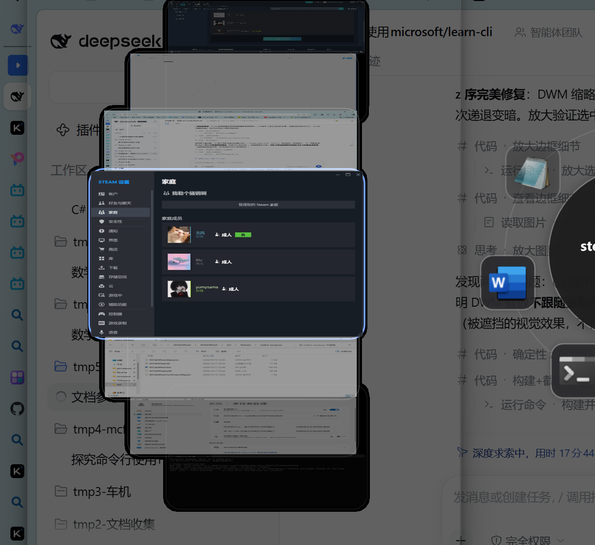

# AltTabWheel

Alt+Tab 轮盘切换器 —— .NET 8 WPF 实现的 Windows 窗口切换替代方案。

按住 Alt 呼出轮盘，窗口图标环形排布；键盘或鼠标指向选择，松开 Alt 即切换。
轮盘左侧是**实时预览轮播**（DWM 缩略图逐帧合成，非快照）：选中卡居中于面板中部、
与轮心同高水平线，亮蓝高亮边框，上下卡依次变小变淡退后，卡片直接悬浮在桌面上
（窗口本体被裁剪成卡片轮廓，无底板），可在设置中关闭。



## 交互

| 操作 | 效果 |
| --- | --- |
| Alt+Tab / Alt+Shift+Tab | 呼出轮盘 / 前进 / 后退 |
| Alt+滚轮 | 前进 / 后退 |
| Alt+方向键 | 按方向选择几何最近的窗口 |
| 鼠标指向（可开关） | 移动鼠标选择对应扇区，与键盘导航自动仲裁互不拉扯 |
| 松开 Alt | 切换到选中窗口 |
| Esc | 取消切换 |

## 任务栏式设计（设置中开关）

- **合并任务栏**：同进程窗口合并为一个扇区（右下角数量角标），选中组即自动
  展开级联子轮盘（StarPie 风格：子扇区在组扇区外侧弧形展开，首个子项直接选中），
  子轮盘内继续 Tab 循环、越界自动收起回顶层。
- **固定任务栏**：按进程名或 exe 路径固定应用。固定项排在轮盘末尾，无窗口时
  半透明显示，选中并松开 Alt 即启动；已有窗口的固定项自动合并到对应窗口。
- **设置页面**：托盘右键 Settings 或命令行 `--settings`。配置持久化在
  `%AppData%\AltTabWheel\settings.json`。

## 实现要点

- **Alt+Tab 拦截**：WH_KEYBOARD_LL + WH_MOUSE_LL 全局低级钩子（方案参考 FlipSwitcher）。
  钩子热路径零 IO / 零分配 / 零 P/Invoke：Alt/Shift 状态由钩子消息流自行跟踪，
  UI 工作经预分配无闭包委托投递 Dispatcher；鼠标钩子按需安装（轮盘关闭时卸载）。
- **窗口枚举**：EnumWindows Z 序遍历（近似 MRU），Raymond Chen IsAltTabWindow 规则，
  DWM cloaked 过滤，topmost 窗口单独成桶追加末尾。
- **呼出响应**：UIA 标题读取偶发秒级卡顿，绝不跑在呼出 UI 线程上——启动后台预热
  填缓存，呼出用快照立即显示，后台线程刷新，结构 diff 不变时跳过轮盘重建；
  刷新请求合并 + 900ms 防抖。
- **标题来源**：UIA 优先（窗口 provider 自报，Edge/微信等自绘窗口也能拿到正确
  中文名），GetWindowTextW + TitleCodec 清洗兜底。
- **图标管线**：256px 统一产出，Fant 下采样锐利显示。窗口 HICON 先经 GetIconInfo
  查原生尺寸，不足 128px 直接跳过（32px 上采样是模糊主因），优先
  IShellItemImageFactory 从 exe 提取最大图标源。光栅化用 Icon.ToBitmap()
  （DrawIconEx 的 AND/XOR 位操作会把半透明边缘画成脏色）；像素直读显式按
  Pbgra32 构造，并做预乘归一化（HBITMAP 互操作丢 alpha 语义会产生黑边）。
- **DPI**：PerMonitorV2，窗口按目标显示器 DPI 把物理像素换算为 DIP。
- **前台激活**：AttachThreadInput 握手 + SetForegroundWindow，最小化窗口先 SW_RESTORE。
- **实时预览轮播**：DWM Thumbnail API，HalfEllipseCarousel 设计（竖直椭圆左半弧 +
  弧长均匀 + 无限循环 + 指数阻尼）。三个硬约束的解法（详见 docs/DEVELOPMENT.md）：
  非 layered 独立宿主（layered 窗口不渲染缩略图）；SetWindowRgn 逐帧把窗口裁剪成
  卡片矩形并集（WPF 非 layered 窗口无 per-pixel alpha，毛玻璃类 API 均无效）；
  z 层由几何保证（远卡缩略图裁掉与近卡的重叠带，DWM 叠放顺序不可控）。
- **预览性能**：渲染循环收敛即停（静止期间零 CPU），帧布局全池化零分配，
  画刷按 alpha 量化 256 级共享冻结。
- **顺序一致性**：预览数据源 = 轮盘遍历序展平（组内窗口原位展开），目标定位
  按 HWND 而非索引——预览高亮卡与轮盘选中扇区严格对应。

## 构建与运行

```powershell
dotnet build .\AltTabWheel.sln -c Release
.\AltTabWheel\bin\Release\net8.0-windows\AltTabWheel.exe            # 正常运行
.\AltTabWheel\bin\Debug\net8.0-windows\AltTabWheel.exe --selftest   # UI 链路自检
.\AltTabWheel\bin\Debug\net8.0-windows\AltTabWheel.exe --settings   # 直接打开设置
```

托盘图标右键可退出/打开设置。调试日志 `%TEMP%\alttabwheel.log`。

> 注意：部分带反作弊的游戏（如腾讯 ACE / 英雄联盟）会系统级拦截合成输入，
> 测试请用 `--selftest` / `--selftest-reorder` 参数或物理按键验证。

## 版本历史

| 版本 | 主题 |
| --- | --- |
| v0.1 | 轮盘切换核心链路（钩子拦截 / 枚举 / 激活 / 轮盘 UI） |
| v0.2 | 鼠标指向、合并/固定任务栏、设置系统、标题与 DPI 根治 |
| v0.3 | DWM 实时预览轮播、快照呼出响应优化、图标 2× 高清 |
| v0.4 | 性能优化（渲染收敛即停 / 零分配 / 按需钩子）、选中↔预览对应修复 |
| v0.5 | 直角卡片、图标 256px + 黑边根治、预览观感美化（去黑布/去抖动） |

详细开发日志（架构决策、实验记录、回归警示）见 [docs/DEVELOPMENT.md](docs/DEVELOPMENT.md)。

## 已知限制

- 窗口很多（>16）时扇区拥挤，需要分页/螺旋层级布局
- 预览窗口 >21（MaxThumbs）时超出项不参与轮播
- 任务管理器等特殊窗口的激活可能被其自身窗口特性干扰
- Z 序为近似 MRU；管理员窗口需以管理员运行本程序（UIPI）

## 参考

- [FlipSwitcher](https://github.com/dianbanjiu/FlipSwitcher) — Alt+Tab 拦截与窗口服务
- [StarPie](https://github.com/Star-Pie/StarPie) — 轮盘 UI、级联子轮盘与工程规范
- [ExplorerPatcher](https://github.com/valinet/ExplorerPatcher) — 任务栏行为参考
- [Microsoft Learn](https://learn.microsoft.com/windows/win32/dwm/thumbnail-ovw) — DWM/Win32 文档
