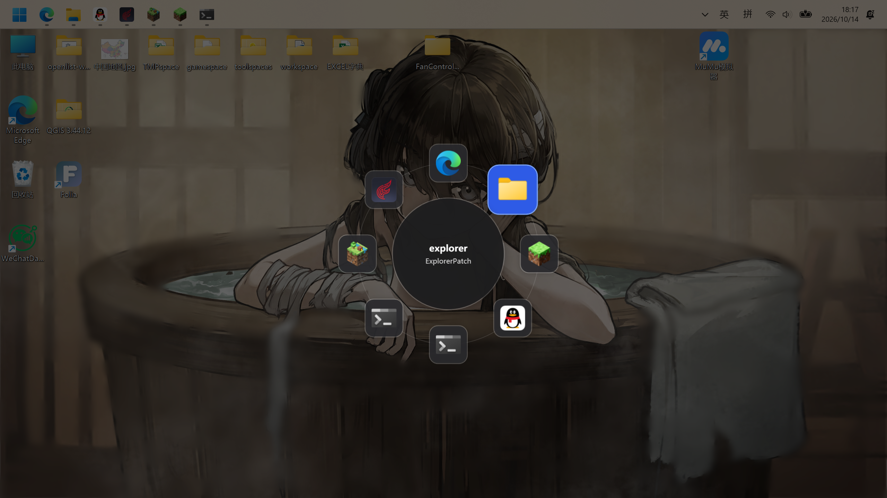

# AltTabWheel

Alt+Tab 轮盘切换器 —— .NET 8 WPF 实现的 Windows 窗口切换替代方案。

按住 Alt 呼出轮盘，窗口图标环形排布，松开 Alt 即切换到选中窗口。



## 交互

| 操作 | 效果 |
| --- | --- |
| Alt+Tab | 呼出轮盘 / 前进一项 |
| Alt+Shift+Tab | 后退一项 |
| Alt+滚轮 | 前进 / 后退 |
| Alt+方向键 | 按方向选择几何最近的窗口 |
| 松开 Alt | 切换到选中窗口 |
| Esc | 取消切换 |

## 实现要点

- **Alt+Tab 拦截**：WH_KEYBOARD_LL 全局低级键盘钩子（方案参考 [FlipSwitcher](https://github.com/dianbanjiu/FlipSwitcher)）。
  钩子回调只读取 vkCode 指针并判定，不做任何 IO，UI 工作投递到 Dispatcher。
- **窗口枚举**：EnumWindows 按 Z 序遍历（近似系统 MRU 顺序），
  按 Raymond Chen 的 IsAltTabWindow 规则过滤（可见 / 非 cloaked / 非工具窗口 / 仅根所有者），
  topmost 窗口单独收集并追加到末尾，避免抢占 MRU 位置。
- **图标**：优先 WM_GETICON（与系统 Alt+Tab 一致），失败则回退 ExtractIconEx 提取程序图标。
- **激活**：AttachThreadInput 经典握手 + SetForegroundWindow，最小化窗口先 SW_RESTORE。
- **UI**：透明无边框置顶覆盖层（WS_EX_NOACTIVATE | WS_EX_TOOLWINDOW，出现在鼠标所在显示器），
  轮盘几何确定性约定：扇区从正上方 -90° 开始顺时针均布，半径随窗口数自适应。
- **DPI**：app.manifest PerMonitorV2。

## 构建与运行

```powershell
dotnet build .\AltTabWheel.sln -c Release
# 开发调试
dotnet build .\AltTabWheel.sln -c Debug
.\AltTabWheel\bin\Debug\net8.0-windows\AltTabWheel.exe
# UI 渲染链路自检（不经过键盘钩子，2 秒后自动打开轮盘）
.\AltTabWheel\bin\Debug\net8.0-windows\AltTabWheel.exe --selftest
```

托盘图标右键可退出。调试日志写入 %TEMP%\alttabwheel.log。

## v0.1 已知限制（后续版本优化方向）

- 窗口很多（超过 16 个）时扇区会拥挤，需要分页 / 螺旋层级布局
- 图标而非实时窗口缩略图（计划接入 DwmRegisterThumbnail）
- 单实例 / 开机自启 / 设置界面 / 主题切换尚未实现
- Z 序为近似 MRU，与系统 Alt+Tab 在多桌面/多显示器场景的顺序可能有差异
- 管理员窗口无法被普通权限实例切换（UIPI，需以管理员运行本程序）

## 参考

- [FlipSwitcher](https://github.com/dianbanjiu/FlipSwitcher) — Alt+Tab 拦截与窗口服务
- [StarPie](https://github.com/Star-Pie/StarPie) — 轮盘 UI 与工程规范
- [ExplorerPatcher](https://github.com/valinet/ExplorerPatcher) — AltTab 相关行为参考
- [Microsoft Learn](https://learn.microsoft.com/windows/win32/dwm/thumbnail-ovw) — DWM 缩略图 / Win32 文档
