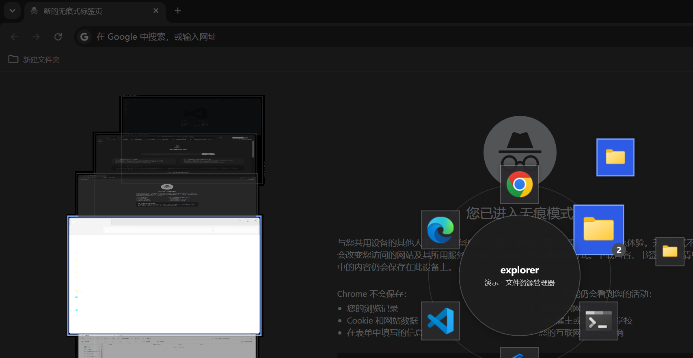

# AltTabWheel
Alt+Tab 轮盘切换器 —— .NET 8 WPF 实现的 Windows 窗口切换替代方案。
 
按住 Alt 呼出轮盘，窗口图标环形排布；键盘或鼠标指向选择，松开 Alt 即切换。


## 效果预览



## 操作

| 按键 / 操作 | 作用 |
| --- | --- |
| `Alt` + `Tab` | 呼出轮盘，选中下一个 |
| `Alt` + `Shift` + `Tab` | 选中上一个 |
| `Alt` + 滚轮 | 前后导航 |
| `Alt` + 方向键 | 选择该方向最近的窗口 |
| 移动鼠标 | 直接指向想选的扇区（可与键盘混用） |
| 松开 `Alt` | 切换到选中的窗口 |
| `Esc` | 取消，回到原窗口 |

## 安装

1. 安装 [.NET 8 桌面运行时](建议）(https://dotnet.microsoft.com/download/dotnet/8.0)（已装可跳过）
2. 到仓库的 **Releases** 页面下载最新压缩包，解压到任意目录
3. 双击运行 `AltTabWheel.exe`

程序常驻系统托盘，不占任务栏。右键托盘图标可以打开**设置**或退出。

> 本程序需要以管理员身份运行。

## 设置

托盘右键 → 设置，可开关：

- **窗口实时预览**（关闭后轮盘更轻量）
- **鼠标指向选择**
- **合并任务栏**：同应用窗口合并，选中展开子轮盘
~~- **固定任务栏**：把常用应用钉在轮盘上~~

配置保存在 `%AppData%\AltTabWheel\settings.json`，修改即时生效。

## 已知限制

- 需要管理员权限的窗口（如任务管理器），本程序也要以管理员身份运行才能切过去
- 全屏独占模式的游戏画面无法实时预览，对应卡片会显示为占位底
- 窗口特别多（16 个以上）时扇区会偏挤，后续会加入分页
- 带内核级反作弊的游戏运行中，可能拦截本程序的按键钩子

## 自行构建

```powershell
dotnet build .\AltTabWheel\AltTabWheel.csproj -c Release
```

技术栈：.NET 8 / WPF / Win32（全局低级键盘钩子、DWM 缩略图合成、UI Automation 标题读取）。
建议 .NET 8 SDK。


